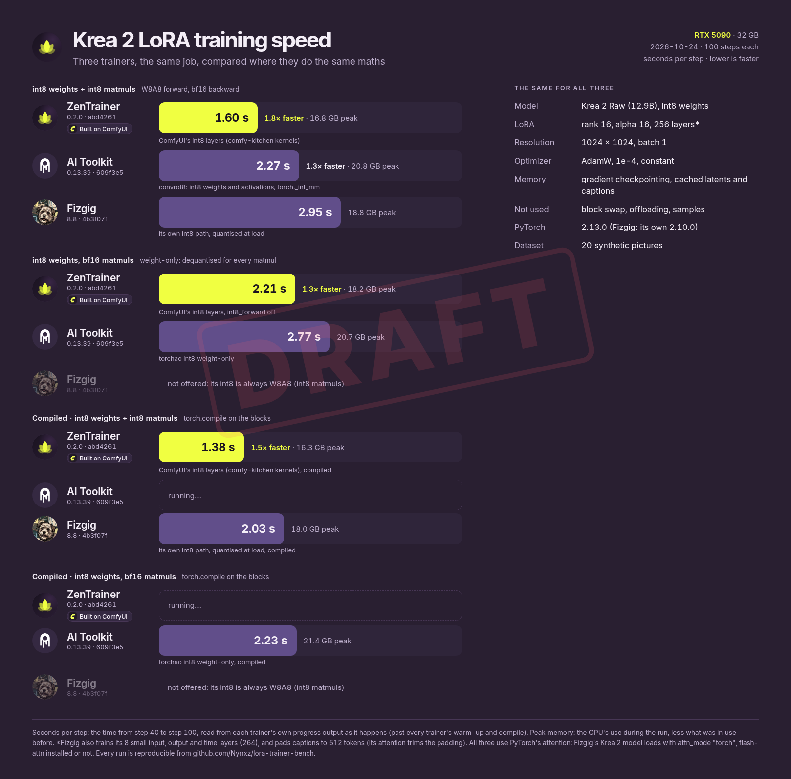
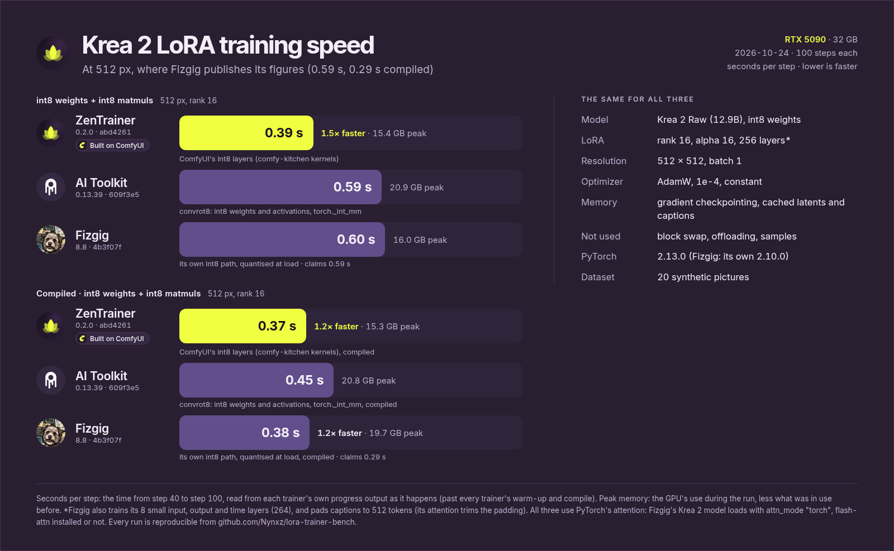
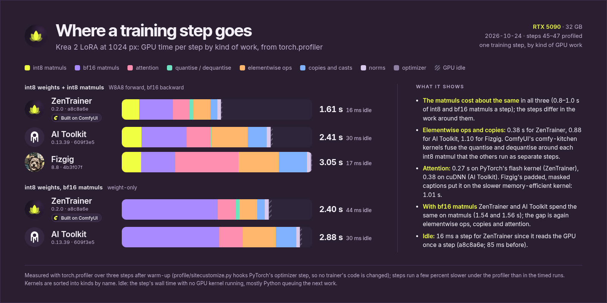

# LoRA trainer benchmark

How fast do LoRA trainers train the same job on the same GPU? This repository measures
[ZenTrainer](https://github.com/Nynxz/ZenTrainer), [AI Toolkit](https://github.com/ostris/ai-toolkit)
and [Fizgig](https://github.com/shootthesound/Fizgig) side by side, and is set up so anyone can rerun
it and check every number. The first comparison is **Krea 2**; other models can join as matrices of
their own.

None of the trainers' code is in here. `trainers/install.sh` clones each one from its own repository
at the commit in [`pins.json`](pins.json) and installs it the way that project says to. What's here
is only the configurations, the dataset generator, the runner and the results.

## Results

RTX 5090 (32 GB), 24 October 2026. Seconds per step, lower is faster; memory is the GPU's peak
during the run over what was in use before it. Each number is a variant in [`matrix.toml`](matrix.toml)
and its latest successful row in [`results/results.jsonl`](results/results.jsonl).

### 1024 px



| | ZenTrainer | AI Toolkit | Fizgig |
|---|---|---|---|
| int8 weights + int8 matmuls | **1.60** · 16.8 GB | 2.27 · 20.8 GB | 2.95 · 18.8 GB |
| int8 weights, bf16 matmuls | **2.21** · 18.2 GB | 2.77 · 20.7 GB | not offered |
| compiled, int8 matmuls | **1.38** · 16.3 GB | 1.74 · 21.3 GB | 2.03 · 18.0 GB |
| compiled, bf16 matmuls | **2.00** · 18.4 GB | 2.23 · 21.4 GB | not offered |

### 512 px



| | ZenTrainer | AI Toolkit | Fizgig |
|---|---|---|---|
| int8 weights + int8 matmuls | **0.39** · 15.4 GB | 0.59 · 20.9 GB | 0.60 · 16.0 GB |
| compiled, int8 matmuls | **0.37** · 15.3 GB | 0.45 · 20.8 GB | 0.38 · 19.7 GB |

### Reading them

Rows group trainers that do **the same maths**, so a difference within a row is the trainers'
implementations, not their choice of precision:

| Same maths | ZenTrainer | AI Toolkit | Fizgig |
|---|---|---|---|
| int8 weights + int8 matmuls (W8A8 forward, bf16 backward) | `int8_forward: true` | `qtype: convrot8` | `--precision int8` |
| int8 weights, bf16 matmuls (weight-only) | `int8_forward: false` | `qtype: int8` (torchao) | not offered: its int8 is always W8A8 |

- **Uncompiled, ZenTrainer is about 1.4–1.8× faster at 1024 and 1.5× at 512.** All three run int8
  matmuls in the first row, so it isn't int8 alone. ZenTrainer trains on ComfyUI's int8 layers, whose
  comfy-kitchen CUDA kernels rotate and quantise the activations in one fused step and fold the
  dequantisation into the matmul's epilogue (its `int8_linear`), where the others run separate steps.
- **Compiling closes much of the gap.** torch.compile fuses those small steps for the others: at 512
  it takes Fizgig from 0.60 to 0.38, level with ZenTrainer, while ZenTrainer itself gains about 5%.
  At 1024 ZenTrainer stays ahead compiled: 1.38 against 1.74 (AI Toolkit) and 2.03 (Fizgig).
- **ZenTrainer is also ahead with bf16 matmuls** (2.21 against 2.77), where no int8 kernels run, so
  part of the difference is outside the matmuls. We haven't profiled where yet; that's next.

### Where the time goes



`bench.py profile <variant>…` runs a variant for 60 steps and profiles steps 45–47 with
torch.profiler, writing `results/profiles/<variant>.json`: GPU time per step by kind of kernel, the
time the GPU sat idle, and every kernel. [`profile/sitecustomize.py`](profile/sitecustomize.py) does
it from inside the trainer's Python (loaded through `PYTHONPATH`, hooked on PyTorch's optimizer
step), so no trainer's code is changed; profiled runs aren't results. `BENCH_PROFILE_TRACE=1` also
saves the timeline, and [`profile/who.py`](profile/who.py) totals kernels and idle gaps by the code
that launched them.

At the same maths the three do about the same matmul work. ZenTrainer's steps are shorter in what
surrounds it: fewer elementwise ops and copies (ComfyUI's fused int8 kernels) and PyTorch's flash
attention; Fizgig's masked captions put it on a slower attention kernel. The ZenTrainer rows are
from [`a8c8a6e`](https://github.com/Nynxz/ZenTrainer/commit/a8c8a6e), which reads the GPU once a
step instead of six times (idle 85 → 16 ms; in a timed run 1.60 → 1.58 s). The first round, at
`abd4261`, is kept in `results/profiles/abd4261/`.

### ZenTrainer's own int8 backward

Every row above uses each trainer's standard backward pass, in bf16. ZenTrainer can also run the
input gradient of its int8 layers on int8 tensor cores (`memory.w8a8_backward`, its own kernel):
the gradient is quantised to int8 per row, rounded stochastically. That changes the maths, so it
isn't in the comparison; on its own it takes the 1024 int8 run from 1.60 to **1.35 s/step**
(17.5 GB), uncompiled. Variant `zt-w8a8-int8bwd`.

### Differences that remain, and what they mean

We matched everything we could. These are left, and none changes which maths a row does:

- **The model file.** ZenTrainer reads ComfyUI's ready-quantised int8 file (`krea2_raw_int8_convrot`,
  rotated, a scale per row). AI Toolkit and Fizgig quantise the bf16 file as they load it. This
  affects accuracy slightly, not speed.
- **Caption length.** Fizgig pads every caption to 512 tokens and masks the padding (its attention
  trims it again); the other two use the caption's real length (about 27 tokens here). Fizgig's
  blocks' linear layers do about 12% more work per step.
- **LoRA layers.** Fizgig also trains 8 small layers outside the blocks (input, output, time and text
  projections): 264 against 256. A fraction of a percent of the work.
- **PyTorch.** Each trainer uses the version it ships with: 2.13.0 for ZenTrainer and AI Toolkit,
  2.10.0 for Fizgig.
- **Attention.** All three use PyTorch's SDPA. Fizgig's Krea 2 model loads with `attn_mode="torch"`,
  so flash-attn wouldn't be used even if installed; AI Toolkit asks for the cuDNN kernel; ZenTrainer
  lets PyTorch choose.

If you think a trainer is set up wrong, the configuration is in [`configs/`](configs/) and the
flags in [`bench.py`](bench.py). Open an issue or a pull request: the point is a fair number.

### Checking a trainer against its own figures

Fizgig's code gives 0.5917 s/step at int8 and 0.292 compiled, "measured per step on an RTX 5090,
Krea 2, rank 16", at 0.25 MP (`src/fizgig/utils/capabilities.py`): 512 px, rank 16. The `check`
variants run it there (their ids say `r8` from an earlier reading; they run rank 16).

| Fizgig, 512 px, rank 16 | Its figure | Here |
|---|---|---|
| int8 | 0.592 | **0.595** |
| int8, compiled | 0.292 | **0.384** |

The uncompiled figure reproduces, which is good evidence the setup here is sound. The compiled one
doesn't: its steps are a steady 0.37–0.40 s with no recompiles in the timed window, so the
difference is in the compiled code itself (a different PyTorch version is one candidate).

### About the raw rows

`results.jsonl` keeps every run, including ones that were superseded: ZenTrainer's weight-only rows
before [ZenTrainer `abd4261`](https://github.com/Nynxz/ZenTrainer/commit/abd4261) (where
`int8_forward: false` didn't take effect, so they were W8A8 again) and one run that failed to start.
`bench.py results` and the charts use each variant's latest successful run.

## Running it yourself

Needs Linux, an NVIDIA GPU with at least 24 GB (32 GB recommended), about 64 GB of RAM, about 120 GB
of disk, `git`, `python3` (3.11 or newer) and [uv](https://docs.astral.sh/uv/).

```sh
git clone <this repository> && cd lora-trainer-bench
./run.sh                    # install, download the models, prepare, run everything (a few hours)
```

Or step by step:

```sh
trainers/install.sh zentrainer        # also ai-toolkit, fizgig
scripts/download_models.sh            # the four Krea 2 files, about 45 GB, with their sha256
uv run --no-project --with pyyaml --with pillow python bench.py prepare      # dataset, caches, results/environment.json
uv run --no-project --with pyyaml --with pillow python bench.py run zt-w8a8  # one variant, 100 steps
uv run --no-project --with pyyaml --with pillow python bench.py results      # seconds per step so far
```

Already have the Krea 2 files? Point `paths.models` in [`bench.toml`](bench.toml) at a folder with
ComfyUI's layout (`diffusion_models/`, `text_encoders/`, `vae/`).

Run nothing else on the GPU meanwhile: another program's work would show up as a slower trainer.

## Layout

```
pins.json            each trainer's repository and commit
bench.toml           where the trainers, models and work folder live
matrix.toml          every variant the benchmark runs
configs/             each trainer's configuration (the settings every variant shares)
trainers/install.sh  clones and installs one trainer, as its project documents
scripts/             fetching the models
dataset/             the synthetic dataset generator
bench.py             the runner: prepare, run, results, profile, trial
profile/             the step profiler (sitecustomize.py) and who.py, for its timelines
results/             results.jsonl (every run), environment.json (the machine), models.sha256
chart/               the published chart, made from results/
```

## Licences

This repository's own files are MIT. The trainers are fetched from their own repositories and stay
under their own licences; Krea 2 is under Krea's licence, from Comfy-Org's repository.
